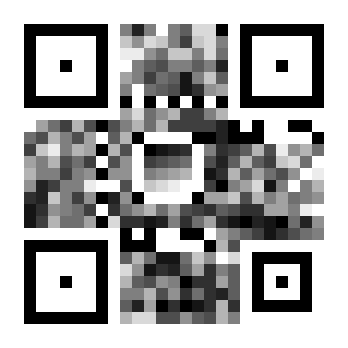
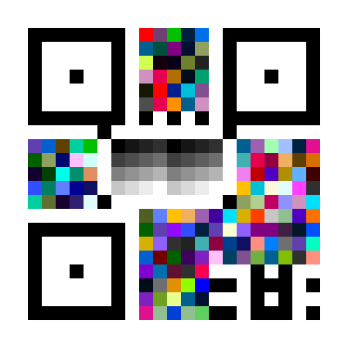
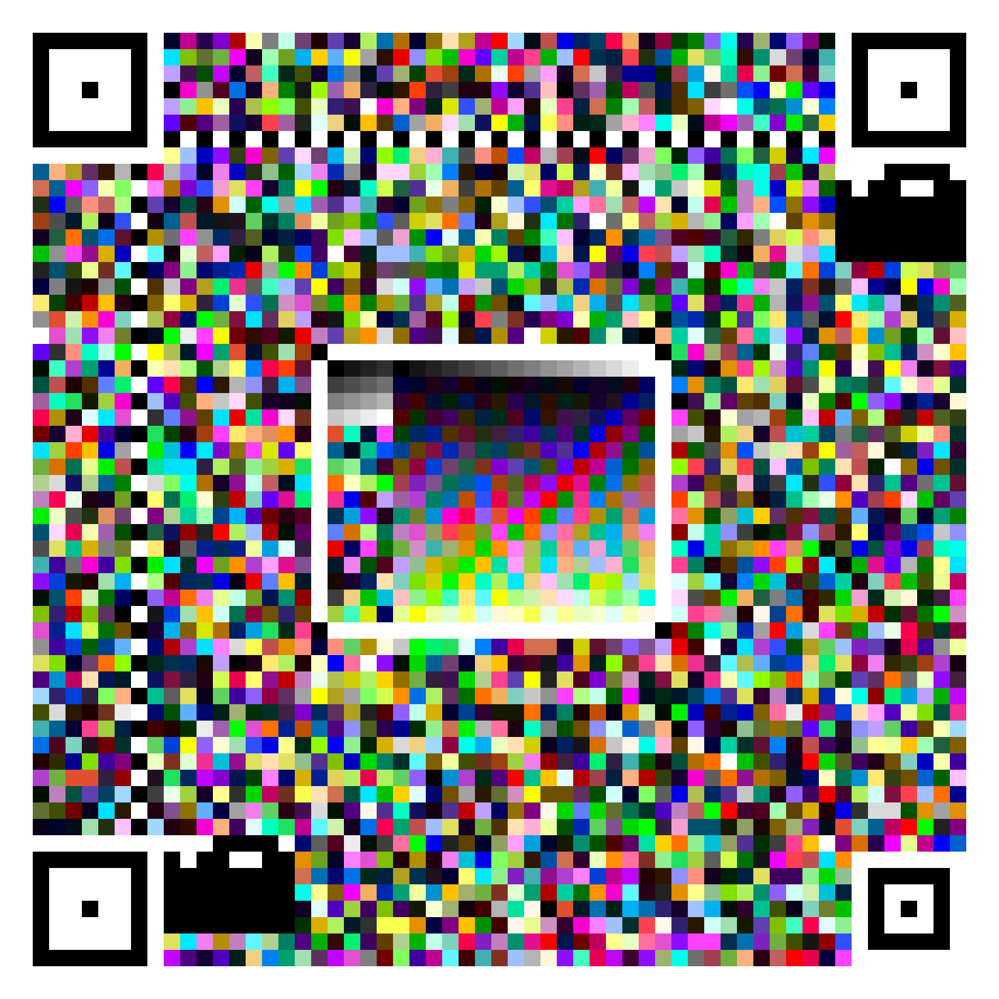
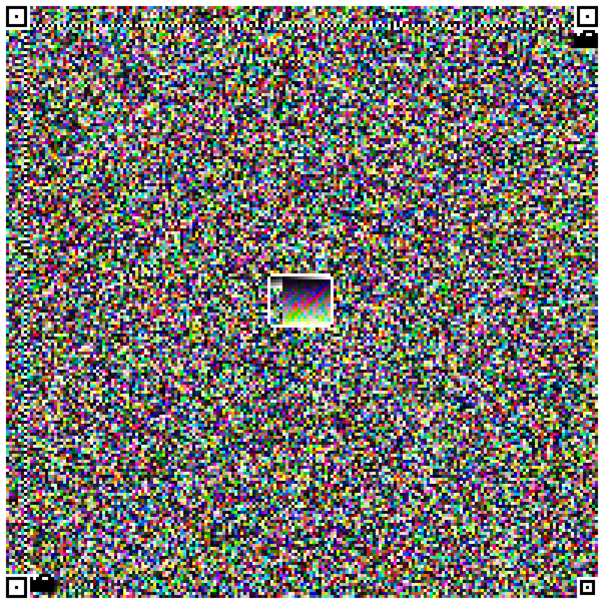
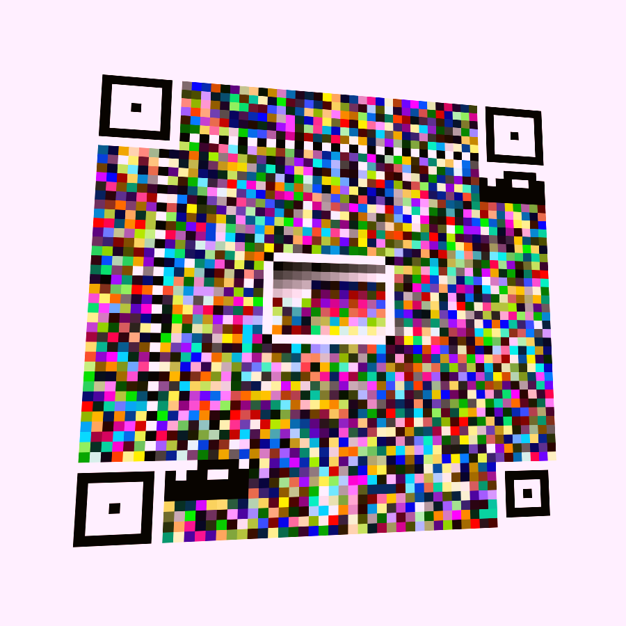

# LCC — Layered Chromatic Code

> 方形、分层、按信道能力换符号表的二维图形码参考实现。
> 旧 HLC（Hexagonal Layered Code）六边形实现已删除，设计文档已由 [LCC 规范](docs/lcc-spec.md) 取代。

LCC 用同一套方形几何承载 L1/L2/L3a/L3b 四层符号表：

| 层 | 符号表 | 名义 bit/模块 | ECC | 典型信道 |
| --- | --- | --- | --- | --- |
| L1 | 2 态黑白 | 1 | 20% | 兜底 |
| L2 | 16 级等 L\* 灰 | 4 | 35% | 屏幕 + 打印 |
| L3a | 64 色（近似 CMYK） | 6 | 40% | 打印 / 保守屏幕 |
| L3b | 256 色（sRGB） | 8 | 40% | 屏幕 / 摄像头 |

## 特性

- **方形动态版本**：`N = 21 + 4(v-1)`，`v=1..100`；最小模块 4px，fill 模式自动铺满画布。
- **自定义定位图案**：`1:2:1:2:1` 同心方环，和 QR 的 `1:1:3:1:1` 明显区分。
- **BR 对齐图案**：`N≥33` 时提供第四个单应锚点，摄像头透视更稳。
- **真 RS(GF(256))**：系统码、分块、交织、Berlekamp-Massey 解码。
- **BCH(15,5) 格式带**：双副本多数投票，版本由几何推导。
- **可逆邻差约束**：16 亮度 rank、`|Δrank|≤8`、Hilbert 顺序 + 分块枚举编码。
- **bucketed / global 双色板**：bucketed 支持约束，global 追求最大色差。
- **摄像头链路**：连通域找 finder + 单应 + 定时图案消歧 + 色板仿射校准。
- **零运行时依赖**：Node 端只用内置 `zlib`；浏览器端只用 Canvas。

## 快速开始

需要 Node.js ≥ 18。

```bash
# 生成两个基础 demo
npm run demo

# 生成《心经》《金刚经》示例
node examples/encode-sutras.js

# 构建 Web 版（把浏览器核心复制到 docs/lib）
npm run build:web

# 本地启动 Web 版
npm run web
# 打开 http://localhost:8080

# 测试
npm test
```

## CLI

```bash
node src/cli.js encode --input "Hello LCC" --output hello.png --layer L2
node src/cli.js encode --input-file examples/心经.txt --output sutra.png --layer L3b --size 2048 --no-constraint
node src/cli.js decode --input sutra.png
node src/cli.js info
```

## API

```js
import { encode, decodeAuto } from './src/index.js';

const result = encode('Hello, LCC!', {
  layer: 'L3b',
  width: 1024,
  height: 1024,
  mode: 'fill',          // 'fill' | 'compact'
  paletteMode: 'bucketed', // 'bucketed' | 'global'
  constraint: false,     // 摄像头场景建议 false
});

console.log(result.meta);
// { layer, version, N, moduleSize, bitsPerModule, payloadCapacity, ... }

const decoded = decodeAuto({
  width: result.image.width,
  height: result.image.height,
  data: result.image.data,
});
console.log(decoded.text);
```

- `encode()` 返回原始 RGB 图像（`{width,height,data}`），可直接画到 Canvas 或写成 PNG。
- `decodeAuto()` 先尝试轴对齐检测，再尝试透视检测。
- Node 端 PNG 读写见 `src/png.js`。

## Web 版 / GitHub Pages

Web 版在 `docs/`：

- `docs/index.html`：编码 + 扫描 UI。
- `docs/app.js`：Canvas 编码、文件上传、摄像头拍照、连续扫描。
- `docs/lib/`：由 `npm run build:web` 从 `src/` 复制，浏览器兼容。
- `docs/lcc-spec.md`：本规范。

部署到 GitHub Pages：仓库 Settings → Pages → Source 选择 `Deploy from a branch`，目录选 `/docs`。

摄像头需要 HTTPS 或 localhost。摄像头模式建议使用 **L3b + 2048² + constraint off**。

## 示例

| 示例 | 图像 | 说明 |
| --- | --- | --- |
| L2 短文本 |  | 25×25 模块，17px，约束开启 |
| L3b 短 URL |  | 21×21 模块，20px，约束开启 |
| 心经 |  | 944B，v10 / N=57，32px |
| 金刚经 |  | 20406B，v45 / N=197，10px |
| 摄像头模拟 |  | 透视 + 色偏 + constraint off，Web 扫描可直接识别 |

关于 finder 开销：三个 finder 固定 192 模块。N=21 时占 43.5%，N=57 时 5.9%，N=197 时 0.5%。小 demo 看起来 finder 很大，是因为 fill 模式为了让小数据铺满画布选了很小的 N；真实数据量下占比会迅速下降。

## 项目结构

```
src/
  encoder.js         编码管线
  decoder.js         轴对齐 + 自动解码
  detector.js        透视检测 / 单应
  calibration.js     L1/L2/L3 校准
  layout.js          finder / 对齐 / 格式带 / 枢纽 / Hilbert
  palettes.js        bucketed / global 色板
  constraint.js      可逆邻差约束
  ecc/               GF(256) / RS / BCH / CRC32
  png.js             Node PNG I/O
  index.js           公共 API
docs/                Web 版 + LCC 规范
examples/            demo 与文本示例
demo_outputs/        生成的示例码面
scripts/             build:web / 本地静态服务
```

## 已知限制

- 约束码在强色偏/噪声下脆弱；摄像头模式默认关闭约束。
- File Mode（24bit 真彩数字承载）尚未实现。
- 多帧/喷泉码尚未实现。
- 打印链路未实测；L3a 是近似 CMYK 色域。
- 小版本（N<33）没有对齐图案，依赖三 finder + 暗角回退。
- 不做 QR 兼容；前端 App 先跑 LCC probe，再决定交给 LCC 还是 QR 解码器。

## 许可证

MIT
