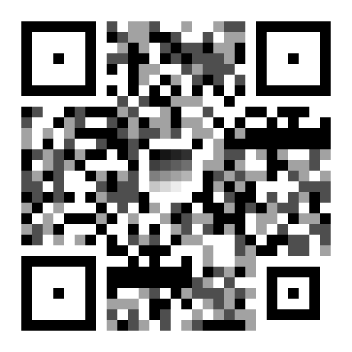
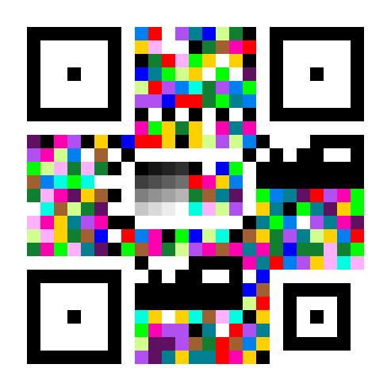
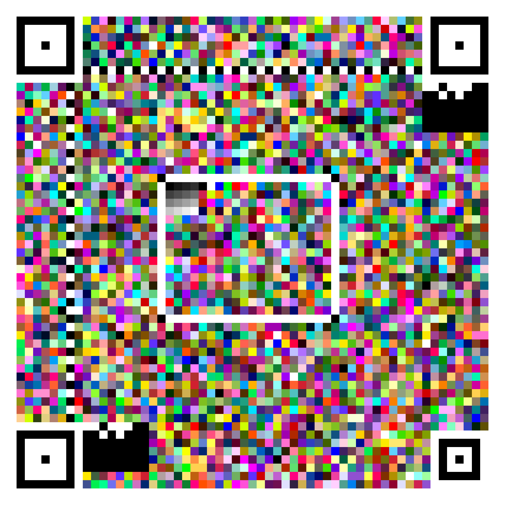
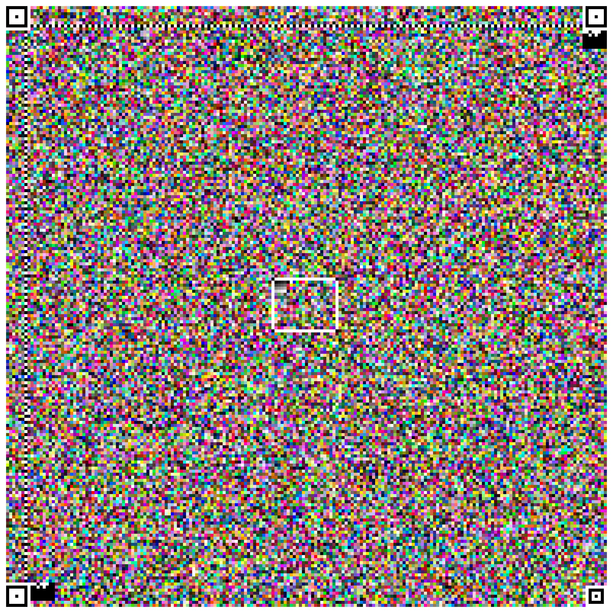

# LCC — Layered Chromatic Code

> 方形、分层、按信道能力换符号表的二维图形码参考实现。
> 旧 HLC（Hexagonal Layered Code）六边形实现已删除，设计文档见 [LCC 规范](docs/lcc-spec.md)。

## 层级

| 层 | 符号表 | bit/模块 | ECC | 摄像头建议 |
| --- | --- | --- | --- | --- |
| **L1** | 2 态黑白 | 1 | 20% | **首选** |
| **L2a** | 4 级等 L\* 灰 | 2 | 20% | **推荐** |
| **L2b** | 8 级等 L\* 灰 | 3 | 30% | 受控拍摄 |
| **L3c** | 16 色 max-min ΔE | 4 | 35% | **摄像头彩色首选** |
| **L3d** | 32 色 max-min ΔE | 5 | 40% | 受控拍摄 |
| **L4e** | 64 色 max-min ΔE | 6 | 40% | 清洁/数字/打印 |
| **L4f** | 256 色 max-min ΔE | 8 | 40% | 清洁/数字/打印 |
| **File** | 24bit 真彩 | 24 | CRC32 | 纯数字，独立模式 |

色板的**最小两两 ΔE** 决定摄像头鲁棒性（实测）：

| 层 | 最小 ΔE |
| --- | ---: |
| L2a（4 灰） | 33.2 |
| L2b（8 灰） | 14.2 |
| L3c（16 色） | **48.8** |
| L3d（32 色） | 35.7 |
| L4e（64 色） | 25.0 |
| L4f（256 色） | 13.7 |

> 16 色比 16 灰更稳，是因为彩色是三维空间；64/256 色太密，只适合清洁/数字/打印。

## 特性

- **方形动态版本**：`N = 21 + 4(v-1)`，`v=1..100`；最小模块 4px，fill 模式自动铺满画布。
- **自定义定位图案**：`1:2:1:2:1` 同心方环，和 QR 的 `1:1:3:1:1` 明显区分。
- **BR 对齐图案**：`N≥25` 提供第四个单应锚点。
- **真 RS(GF(256))**：系统码、分块、交织、Berlekamp-Massey 解码。
- **BCH(15,5) 格式带**：双副本多数投票，版本由几何推导。
- **可逆邻差约束**：按层的 rank 数（4/8/16）和 `maxDiff` 参数化。
- **max-min ΔE 色板**：16/32/64/256 色，最小 ΔE 可测。
- **QR 式预处理**：Otsu / Bradley 自适应阈值、闭运算、多假设重试、V 通道 finder 检测、四锚点单应、局部光照归一化、Viterbi 约束修正。
- **零运行时依赖**：Node 端只用内置 `zlib`；浏览器端只用 Canvas。

## 快速开始

需要 Node.js ≥ 18。

```bash
npm run demo                 # L2a + L3c demo
node examples/encode-sutras.js  # 心经/金刚经 L4f 示例
npm test                     # 测试
npm run build:web            # 复制浏览器核心到 docs/lib
npm run web                  # http://localhost:8080
```

## CLI

```bash
node src/cli.js encode --input "Hello LCC" --output hello.png --layer L1
node src/cli.js encode --input "彩色" --output color.png --layer L3c --size 1024 --no-constraint
node src/cli.js decode --input color.png
node src/cli.js info
```

## API

```js
import { encode, decodeAuto } from './src/index.js';

const result = encode('Hello, LCC!', {
  layer: 'L3c',           // L1 | L2a | L2b | L3c | L3d | L4e | L4f
  width: 1024,
  height: 1024,
  mode: 'fill',
  paletteMode: 'maxmin',  // 'maxmin' | 'harmony'
  constraint: false,      // 摄像头建议 false
});

const decoded = decodeAuto({
  width: result.image.width,
  height: result.image.height,
  data: result.image.data,
});
console.log(decoded.text);
```

## Web 版 / GitHub Pages

Web 版在 `docs/`：

- `docs/index.html`：编码 + 扫描 UI。
- `docs/app.js`：Canvas 编码、文件上传、摄像头拍照、连续扫描。
- `docs/lib/`：由 `npm run build:web` 从 `src/` 复制。
- `docs/lcc-spec.md`：规范。

部署到 GitHub Pages：Settings → Pages → Source 选 `Deploy from a branch`，目录选 `/docs`。

摄像头需要 HTTPS 或 localhost。编码面板有：

- **摄像头黑白**：L1 + constraint off。
- **摄像头彩色**：L3c + constraint off。
- 示例按钮：心经/金刚经使用 L4f（高容量）。

## 示例

| 示例 | 图像 | 说明 |
| --- | --- | --- |
| L2a 短文本 |  | 4 级灰，摄像头友好 |
| L3c 短 URL |  | 16 色，min ΔE ≈ 49 |
| 心经 |  | 944B，L4f |
| 金刚经 |  | 20406B，L4f |
| 摄像头模拟 |  | 透视 + 色偏，L3c |

关于 finder 开销：三个 finder 固定 192 模块。N=21 时占 43.5%，N=57 时 5.9%，N=197 时 0.5%。小 demo 看起来 finder 很大，是因为 fill 模式为了让小数据铺满画布选了很小的 N。

## 摄像头建议

- **L1 / L2a / L3c**：首选。
- **L2b / L3d**：受控拍摄，避开屏幕高光和强反光。
- **L4e / L4f**：清洁截图、文件、数字、打印；不建议随手拍。
- 摄像头场景关闭 constraint；清洁数字码可以开启。
- 多级灰/彩在强反光/高光削顶下仍可能丢级；这不是 finder 检测问题，而是多级量化问题。

## 项目结构

```
src/
  encoder.js         编码管线
  decoder.js         轴对齐 + 自动解码
  detector.js        透视检测 / 单应
  preprocess.js      Otsu / 自适应阈值 / 闭运算 / 多假设
  illumination.js    finder/alignment 黑白云模型
  local-rank.js      L2 局部 rank 分类
  calibration.js     L1/灰/彩校准
  layout.js          finder / 对齐 / 格式带 / 枢纽 / Hilbert
  palettes.js        gray / max-min ΔE 色板
  constraint.js      可逆邻差约束（参数化 rank）
  ecc/               GF(256) / RS / BCH / CRC32
  png.js             Node PNG I/O
  index.js           公共 API
docs/                Web 版 + LCC 规范
examples/            demo 与文本示例
demo_outputs/        生成的示例码面
scripts/             build:web / 本地静态服务
```

## 已知限制

- L2b/L3d 在强反光/高光削顶下仍可能失败；摄像头首选 L1/L2a/L3c。
- L4e/L4f 面向清洁/数字/打印，不建议随手拍。
- File Mode（24bit 真彩）尚未实现。
- 多帧/喷泉码尚未实现。
- 打印链路未实测；真实打印需要逐机校准。
- 不做 QR 兼容；finder 比例 1:2:1:2:1。

## 许可证

MIT
