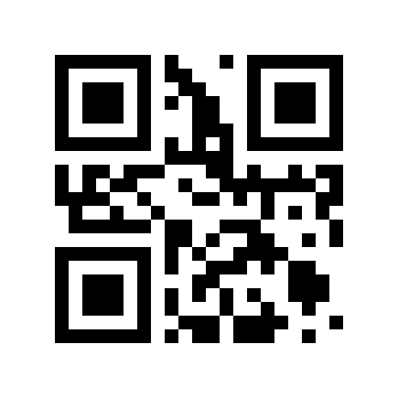
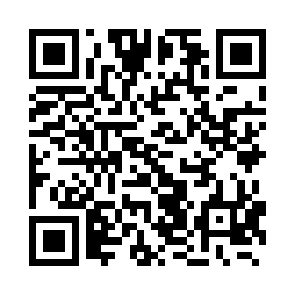
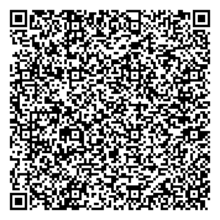
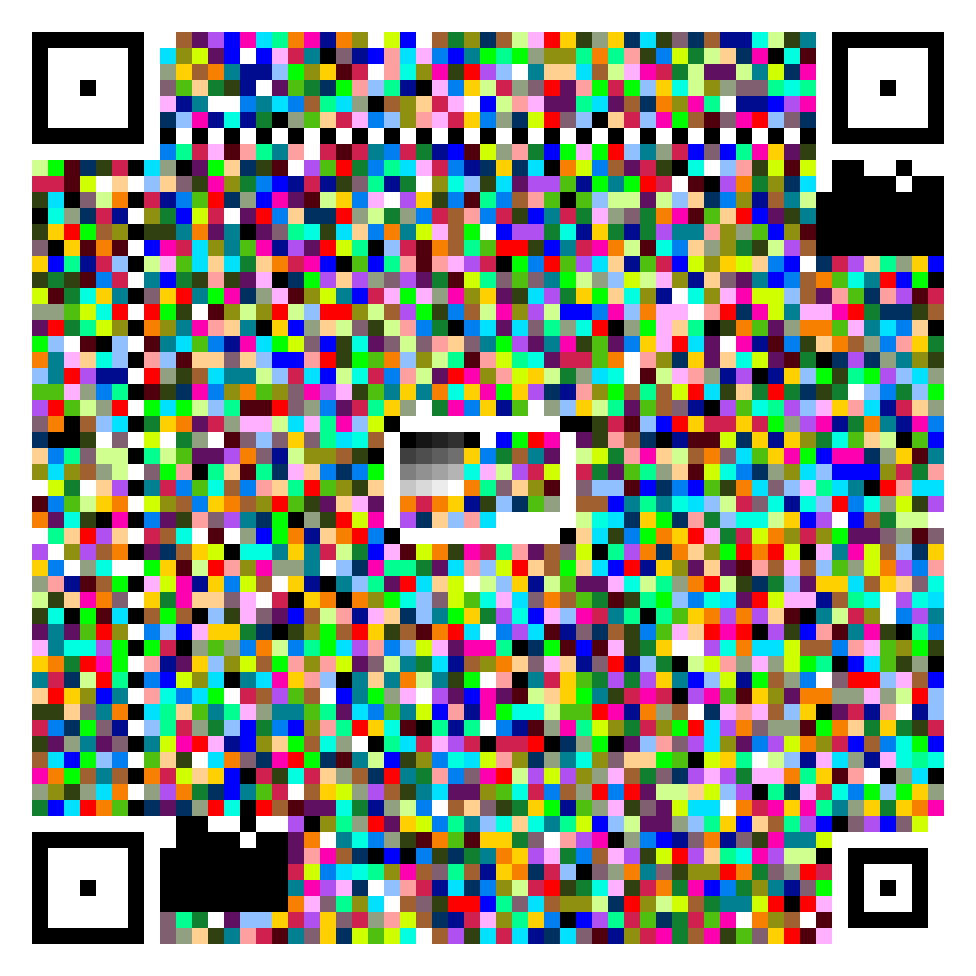
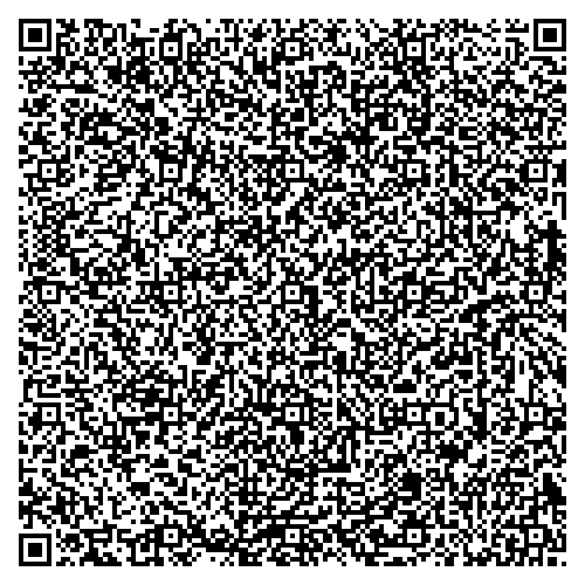
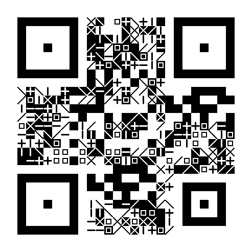
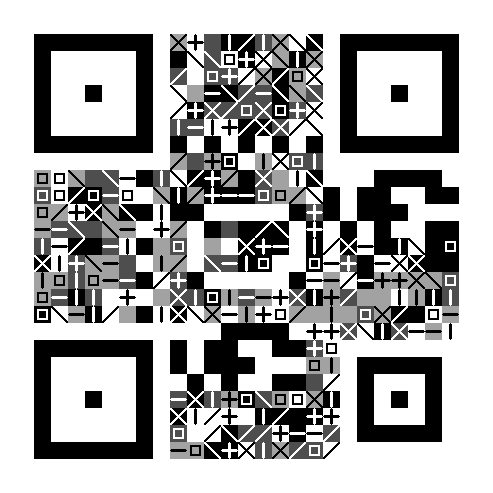
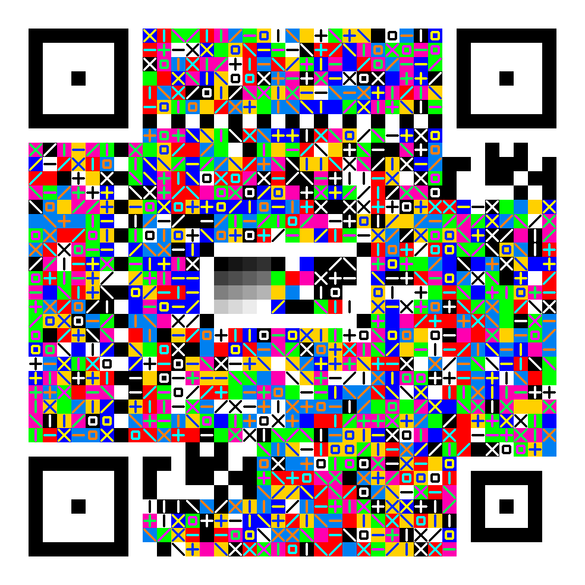

# LCC — Layered Chromatic Code

> ⚠️ **测试阶段警告**
>
> LCC 目前是研究 / 参考实现，**编码格式、层表、色板、格式带、约束方案随时可能完全更改**。
> 请不要用于生产、长期存档、支付、身份凭证或任何不可恢复的数据。请谨慎使用。

LCC 是一套方形、分层、按信道能力换符号表的二维图形码。旧 HLC（Hexagonal Layered Code）六边形实现已删除，设计文档见 [LCC 规范](docs/lcc-spec.md)。

## 层级

### 基础层：无图案

| 层 | 符号表 | bit/模块 | ECC | 摄像头建议 |
| --- | --- | --- | --- | --- |
| **L1** | 2 态黑白 | 1 | 20% | **首选** |
| **L2a** | 4 级等 L\* 灰 | 2 | 20% | **推荐** |
| **L3b** | 8 色 max-min ΔE | 3 | 30% | 推荐 |
| **L2b** | 8 级等 L\* 灰 | 3 | 30% | 受控拍摄 |
| **L3c** | 16 色 max-min ΔE | 4 | 35% | **摄像头彩色首选** |
| **L3d** | 32 色 max-min ΔE | 5 | 40% | 受控拍摄 |
| **L4e** | 64 色 max-min ΔE | 6 | 40% | 清洁/数字/打印 |
| **L4f** | 256 色 max-min ΔE | 8 | 40% | 清洁/数字/打印 |
| **L3u** | 32 色 + 32 形状 | 10 | 35% | 受控/打印 |
| **L4eS** | 64 色 + 32 形状 | 11 | 40% | 数字/打印 |
| **L4fS** | 256 色 + 32 形状 | 13 | 40% | 清洁数字/打印 |
| **File** | 24bit 真彩 | 24 | CRC32 | 纯数字，独立模式 |

### 形状层

经典形状层在每个模块内叠加 8 种图案之一：空白、`/`、`\`、`X`、`+`、`-`、`|`、`□`，增加 3 bit/模块。图案使用与背景色对比度最高的前景色（互补色，或黑/白）。

富形状层在 8 种经典图案上再增加 24 种：V 形角、中线箭头、对角线箭头、1/4 方格、中线 T、对角线 T，共 32 种符号，增加 5 bit/模块。富形状层面向受控拍摄/打印/数字场景，模块最低建议 16 px，不建议手机随手拍。

| 层 | 背景符号表 | 形状 | bit/模块 | 建议 |
| --- | --- | --- | --- | --- |
| **L1s** | 2 态黑白 | 8 | 4 | 灰度摄像头 |
| **L2s** | 4 级灰 | 8 | 5 | 灰度摄像头/打印 |
| **L3s** | 8 色 | 8 | 6 | **彩色摄像头首选** |
| **L3t** | 16 色 | 8 | 7 | 受控拍摄/打印，`N≥25` |
| **L3u** | 32 色 | 32 | 10 | 受控/打印，模块 ≥16 px |
| **L4eS** | 64 色 | 32 | 11 | 数字/打印，模块 ≥16 px |
| **L4fS** | 256 色 | 32 | 13 | 数字/打印，`N≥33` |

### 1–7 bit 阶梯

| bit/模块 | 方案 |
| ---: | --- |
| 1 | L1（黑白） |
| 2 | L2a（4 灰） |
| 3 | L3b（8 色）或 L2b（8 灰） |
| 4 | L3c（16 色）或 L1s（黑白 + 8 形态） |
| 5 | L2s（4 灰 + 8 形态）或 L3d（32 色） |
| 6 | L3s（8 色 + 8 形态）或 L4e（64 色） |
| 7 | L3t（16 色 + 8 形态） |
| 8 | L4f（256 色，数字/打印） |
| 10 | L3u（32 色 + 32 形状） |
| 11 | L4eS（64 色 + 32 形状） |
| 13 | L4fS（256 色 + 32 形状） |

> 形状层需要更大的模块：4 px 只适合纯颜色层；8 形状层 **16 px 是摄像头最低建议**，32 形状层同样最低 16 px，且只用于数字/打印/受控场景。不指定 `moduleSize` 时，`fill` 模式会优先选能放下的最大模块（更少元素、更大的方块）。数字/打印至少 8–12 px。
> 小载荷下 L3t 也会自动用大模块（例如 1024 画布、12 B 载荷 → v2 / N=25 / 32 px）；只有大载荷时才会降到 16 px 左右。

色板的**最小两两 ΔE** 决定摄像头鲁棒性（实测）：

| 层 | 最小 ΔE |
| --- | ---: |
| L2a（4 灰） | 33.2 |
| L2b（8 灰） | 14.2 |
| L3b（8 色） | 80.2 |
| L3c（16 色） | **48.8** |
| L3d（32 色） | 35.7 |
| L4e（64 色） | 25.0 |
| L4f（256 色） | 13.7 |

> 16 色比 16 灰更稳，是因为彩色是三维空间；64/256 色太密，只适合清洁/数字/打印。
> 灰度层的校准枢纽显示该层自身的 4/8 级灰；彩色层才使用 16 级参考灰。

## 快速开始

需要 Node.js ≥ 18。

```bash
npm run demo                 # 生成下面 5 个基础文本示例
npm run shape:examples       # 生成前 4 个文本的形状层示例
npm test                     # 测试
npm run build:wasm           # 编译 C 合成/解码核心到 docs/lib/lcc.wasm（有 emcc 用 Emscripten，否则用 zig）
npm run build:web            # 复制浏览器核心到 docs/lib（保留 wasm）
npm run web                  # http://localhost:8080
```

QR 对比图用 [segno](https://pypi.org/project/segno/) 生成，仅用于文档，不是 LCC 依赖：

```bash
python3 -m pip install segno
npm run qr:examples
```

## 示例

下面 5 个文本使用不同的 LCC 层；QRCode 列使用相同文本、error level M 生成。  
**金刚经数据量过大，不展示 QRCode**，这正是 L4f 容量优势的场景。

| 文本 | 大小 | LCC | QRCode | 说明 |
| --- | ---: | --- | --- | --- |
| **Hello World!** | 12 B | <br>L1 · v2 / N=25 · 17px · ECC L | <br>QR v1 · 21×21 | 最小黑白码 |
| **The quick brown fox jumps over the lazy dog.** | 44 B | <br>L2a · v2 / N=25 · 17px · ECC L | <br>QR v4 · 33×33 | 4 级灰，摄像头友好 |
| **Lorem ipsum**（完整段落） | 446 B | <br>L3c · v7 / N=45 · 20px · ECC Q | <br>QR v16 · 81×81 | 16 色，min ΔE ≈ 49 |
| **心经** | 944 B | <br>L3d · v10 / N=57 · 16px · ECC H | <br>QR v25 · 117×117 | 32 色，受控拍摄 |
| **金刚经** | 20406 B | <br>L4f · v45 / N=197 · 10px · ECC H | 不展示（20 KB，QR 会非常密） | 256 色，清洁/数字/打印 |

## 形状层示例

下面 4 个文本使用带图案的形状层；图案为 `blank / \ X + - | □` 之一，每个模块额外 3 bit。  
前四个基础示例都有对应的形状版本，全部 `decoded=OK corrected=0`。金刚经 20 KB 仍用 L4f（L3t 7-bit 在 2048/16px 下容量不足）。

| 文本 | 大小 | 形状层 | 图案 |
| --- | ---: | --- | --- |
| **Hello World!** | 12 B | <br>L1s · v2 / N=25 · 17px · 4 bit | 黑白 + 8 形态 |
| **The quick brown fox jumps over the lazy dog.** | 44 B | <br>L2s · v2 / N=25 · 17px · 5 bit | 4 灰 + 8 形态 |
| **Lorem ipsum**（完整段落） | 446 B | <br>L3s · v5 / N=37 · 24px · 6 bit | 8 色 + 8 形态 |
| **心经** | 944 B | <br>L3t · v8 / N=49 · 19px · 7 bit | 16 色 + 8 形态 |

生成：

```bash
npm run shape:examples
```

## LCC vs QRCode

| 维度 | LCC | QRCode |
| --- | --- | --- |
| 模块 / 符号 | 方形；1–7 bit 阶梯（L4f 为 8 bit） | 黑白二值，1 bit/模块 |
| 颜色 | L3c/L3d/L4e/L4f 彩色 | 单色 |
| 定位图案 | `1:2:1:2:1` 自定义方环 | `1:1:3:1:1` |
| 校准 | 灰阶/色板校准枢纽 | 无（二值阈值） |
| 纠错 | RS(GF256) + BCH 格式带 + CRC32；L/M/Q/H + Boost | RS + 格式信息；L/M/Q/H |
| 输出 | PNG / SVG | Bitmap / Vector |
| 容量 | 彩色层更高；L4f 可放 20 KB 文本 | 单色，容量较低 |
| 摄像头 | L1/L2a/L3b/L3c/L3s 可用；形状层需更大模块；多级受反光/削顶影响 | 极成熟，全球通用 |
| 生态 | 测试阶段，无通用扫描器 | ISO/IEC 18004，所有手机支持 |
| 稳定性 | 方案可能完全更改 | 稳定标准 |

> LCC 的彩色层是“用色板间距换容量”：16 色可以比 16 灰更稳，但 64/256 色在摄像头下会迅速变差。QR 用二值换取通用性和鲁棒性。

## 特性

- **方形动态版本**：`N = 21 + 4(v-1)`，`v=1..100`；最小模块 4px，fill 模式自动铺满画布。
- **形状维度**：经典 8 种线形态增加 3 bit/模块；富形状层 32 种符号增加 5 bit/模块，形成 1–13 bit 阶梯。
- **高对比前景**：形状使用背景色的互补色或黑/白中对比度最高的颜色，避免中灰互补色消失。
- **多帧叠加**：摄像头可一次捕获 1/3/5 帧，按检测结果对齐到 canonical 网格后平均，降低随机噪声；统计面板显示帧间 σ。
- **自定义定位图案**：`1:2:1:2:1` 同心方环，和 QR 的 `1:1:3:1:1` 明显区分。
- **BR 对齐图案**：`N≥25` 提供第四个单应锚点。
- **真 RS(GF(256))**：系统码、分块、交织、Berlekamp-Massey 解码。
- **ECC 可选**：L/M/Q/H（20/30/35/40%）+ Boost ECC；同版本内自动提高纠错。
- **高级尺寸控制**：版本范围、静区、模块尺寸可覆盖。
- **SVG / 统计**：矢量输出 + 结构化统计面板。
- **BCH(15,5) 格式带**：双副本多数投票，版本由几何推导。
- **可逆邻差约束**：按层的 rank 数（4/8/16）和 `maxDiff` 参数化。
- **max-min ΔE 色板**：16/32/64/256 色，最小 ΔE 可测。
- **QR 式预处理**：Otsu / Bradley 自适应阈值、闭运算、多假设重试、V 通道 finder 检测、四锚点单应、局部光照归一化、Viterbi 约束修正。
- **零运行时依赖**：Node 端只用内置 `zlib`；浏览器端只用 Canvas。

## CLI

```bash
node src/cli.js encode --input "Hello LCC" --output hello.png --layer L1
node src/cli.js encode --input "彩色" --output color.png --layer L3c --size 1024 --no-constraint
node src/cli.js encode --input "形状" --output shape.png --layer L3s --size 1024 --module-size 16
node src/cli.js decode --input color.png
node src/cli.js info
```

## API

```js
import { encode, decodeAuto } from './src/index.js';

const result = encode('Hello, LCC!', {
  layer: 'L3s',           // L1 | L2a | L3b | L3c | L1s | L2s | L3s | L3t | L3u | L4eS | L4fS | ...
  width: 1024,
  height: 1024,
  mode: 'fill',
  paletteMode: 'maxmin',  // 'maxmin' | 'harmony'
  // moduleSize: 16,      // 可选；不填则 auto，优先选能放下的最大模块
  constraint: false,      // 摄像头建议 false
});

const decoded = decodeAuto({
  width: result.image.width,
  height: result.image.height,
  data: result.image.data,
});
console.log(decoded.text);
```

## ECC 与高级选项

| 选项 | 取值 | 说明 |
| --- | --- | --- |
| ECC | `auto` / `L` / `M` / `Q` / `H` | 20% / 30% / 35% / 40% |
| Boost ECC | on / off | 同一版本内选能放下的最高 ECC |
| 版本范围 | 1–100 | 限制自动选档；`version` 可强制指定 |
| 模块尺寸 | Auto / 4–32px | 固定每模块像素；Auto 由 fill/compact 决定 |
| 静区 | Auto / 2 / 4 / 6 | 屏幕默认 2，打印/摄像头建议 4 |
| 输出 | PNG / SVG | SVG 适合打印和排版 |

```js
const result = encode('Hello', {
  layer: 'L3c',
  eccLevel: 'Q',       // auto/L/M/Q/H
  boostEcc: true,      // 同版本内尽量提高
  minVersion: 1,
  maxVersion: 100,
  moduleSize: undefined, // 或 4/6/8/...
  quietZone: 4,
});
```

Web 编码面板的“高级设置”里可以直接调这些参数；生成后统计面板会显示 ECC、色板 min ΔE、约束 rank、数据/功能模块、容量等。  
“下载 SVG”输出矢量码面。

## 研究

- [LCC vs Cimbar：差距、形状维度与增强路线](docs/research/cimbar-vs-lcc-and-shape.md)：Cimbar 对比、形状 + 颜色符号设计草案、验证计划与风险。形状维度已按“线形态”方案实现；报告保留为研究记录。
- [微信二维码模型与 WASM 速度](docs/research/wechat-qr-models-and-wasm-speed.md)：检测网和超分网各自替换哪一段、能不能减 LCC 的前置，以及扫描重复解码为什么比模型更值得先做。研究记录，尚未训练或接入。
- [LCC 形状层超分与 finder 检测的小模型实验](docs/research/lcc-cnn-finder-superscale-experiment.md)：用编码器合成数据训练 finder 热图网和 8 形态超分网，手写 C 算子接进 WASM。finder 和超分默认不启用；换成 C 实际残差训练的形状分类器有增益（`blur_shape` 44.6% → 57.5%，真实照片 4/13 → 5/13），作为可选层 `16` 保留。
- [LCC 编码与解码联合调研报告](docs/research/lcc-encoding-decoding-co-design.md)：把解码侧调研和编码侧可调整空间放在一起。结论是优先做 RS erasure、相机 profile、Gray 映射、亮度/色度分离、形状集/线宽、校准图案和 C 残差分类器；不建议继续加通用 SR、全图 finder 或 Transformer 解码器。

## Web 版 / GitHub Pages

Web 版在 `docs/`：

- `docs/index.html`：编码 + 扫描 UI。
- `docs/app.js`：Canvas 编码、文件上传、摄像头拍照、连续扫描。
- `docs/lib/`：由 `npm run build:web` 从 `src/` 复制。
- `docs/lcc-spec.md`：规范。

部署到 GitHub Pages：Settings → Pages → Source 选 `Deploy from a branch`，目录选 `/docs`。

编码面板包含“高级设置”（ECC、Boost ECC、版本范围、模块尺寸、静区）、统计面板和 PNG/SVG 下载。

摄像头需要 HTTPS 或 localhost。编码面板有：

- **摄像头黑白**：L1 + constraint off。
- **摄像头彩色**：L3c + constraint off。
- **摄像头形态**：L3s + constraint off，模块尺寸 auto。
- **多帧**：1/3/5 帧叠加，默认 3 帧。
- 示例按钮：心经/金刚经使用 L4f（高容量）。

## 摄像头与多帧叠加

- 手机摄像头需要 **HTTPS 或 localhost**，并且必须由用户点击后才能请求权限；点击“打开摄像头”或视频区域即可。
- **不要用 `http://192.168.x.x` 测试手机摄像头**：Safari/Chrome 会把它当作不安全上下文并禁用 `getUserMedia`。用 GitHub Pages、Cloudflare Tunnel、ngrok 等 HTTPS 地址，或在电脑上开 `http://localhost:8080`。
- 打开失败时会自动回退约束：1920×1080 → 1280×720 → `environment` → 默认摄像头；权限被拒、无摄像头、被其他应用占用都有对应提示。失败状态会显示 `secure / protocol / mediaDevices / error` 诊断信息。
- “多帧”可选 1/3/5 帧。连续扫描或拍照时，每帧独立检测，按 `version/N` 分组，统一投影到 canonical 模块网格后平均，再交给正常解码器。
- 多帧平均主要降低随机噪声、传感器噪声和压缩噪声；对随机噪声的理论增益约为 `√N`。它不修复运动模糊或失焦。中性色偏由 finder/alignment 的分通道黑白场矫正，不靠多帧平均。
- 网页扫描优先走 `docs/lib/lcc.wasm`。单帧和多帧都在 C 里完成透视侦测、合成和解码；画面长边超过 960 像素时先缩小再找定位标记。形状用模板匹配。WASM 失败或遇到 constraint 码时回退到 JS。
- 多帧叠加要求码面基本静止；未来做动画/喷泉码时，不能把不同 payload 的帧直接平均，必须按帧 ID 分组。
- 扫描统计会显示叠加帧数、canonical 模块尺寸和帧间 σ，作为置信度参考；最终仍由 RS + CRC 校验。

## 摄像头建议

- **L1 / L2a / L3b / L3c / L3s**：首选。
- **L2b / L3d / L1s / L2s**：受控拍摄，避开屏幕高光和强反光。
- **L3t**：受控拍摄/打印，`N≥25`；模块 Auto 优先选更大，最低建议 16 px。
- **L4e / L4f**：清洁截图、文件、数字、打印；不建议随手拍。
- **L3u / L4eS / L4fS**：32 形状富符号层，面向受控/打印/数字；模块最低 16 px，不建议手机随手拍。
- 形状层需要更大模块：4 px 只适合纯颜色层，摄像头建议 16 px。
- 摄像头场景关闭 constraint；清洁数字码可以开启。
- 多级灰/彩在强反光/高光削顶下仍可能丢级；这不是 finder 检测问题，而是多级量化问题。

## 项目结构

```
native/            C 合成与扫描解码，编译为 docs/lib/lcc.wasm
src/
  encoder.js         编码管线
  decoder.js         轴对齐 + 自动解码 + 灰度多假设
  detector.js        透视检测 / 单应
  preprocess.js      Otsu / 自适应阈值 / 闭运算 / 多假设
  illumination.js    finder/alignment 分通道黑白场
  local-rank.js      L2 局部 rank 分类
  calibration.js     L1/灰/彩校准
  layout.js          finder / 对齐 / 格式带 / 枢纽 / Hilbert
  palettes.js        gray / max-min ΔE 色板
  shapes.js          8 种线形态、前景色、2-means/模板匹配
  stack.js           多帧检测、canonical 对齐与平均
  constraint.js      可逆邻差约束（参数化 rank）
  ecc/               GF(256) / RS / BCH / CRC32
  png.js             Node PNG I/O
  index.js           公共 API
docs/                Web 版 + LCC 规范
examples/            文本示例与 Lorem 文本
demo_outputs/        LCC 示例图 + QR 对比图
scripts/             build:wasm / build:web / 本地静态服务 / QR 对比图
```

## 已知限制

- L2b/L3d 在强反光/高光削顶下仍可能失败；摄像头首选 L1/L2a/L3b/L3c/L3s。
- L4e/L4f 面向清洁/数字/打印，不建议随手拍。
- File Mode（24bit 真彩）尚未实现。
- 形状层已实现（L3b/L1s/L2s/L3s/L3t/L3u/L4eS/L4fS），但真实相机/打印 benchmark 尚未完成；4 px 模块不支持形状，摄像头建议 16 px。
- L3t（16 色 + 8 形态，7 bit）需要 `N≥25`；L4fS（256 色 + 32 形态，13 bit）需要 `N≥33`。32 形状层面向数字/打印/受控拍摄。
- 多帧叠加目前是图像空间平均，尚未做逐模块方差/erasure、跨帧跟踪或运动补偿；码面移动、动画码和喷泉码不适用。
- 手机摄像头需要 HTTPS 或 localhost，且需要用户点击授权。
- 多帧/喷泉码尚未实现。
- 打印链路未实测；真实打印需要逐机校准。
- 不做 QR 兼容；finder 比例 1:2:1:2:1。
- 当前处于测试阶段，格式可能完全更改。

## 许可证

MIT
